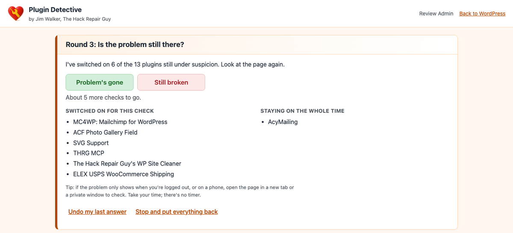
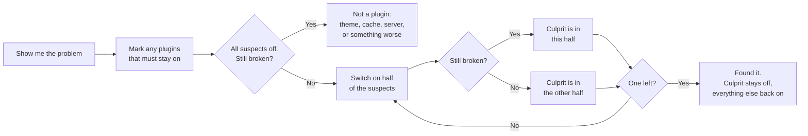
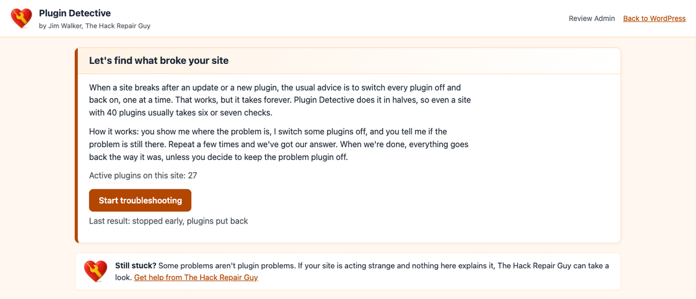
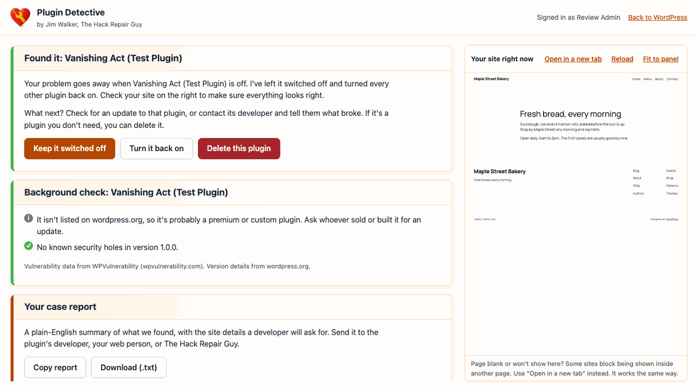
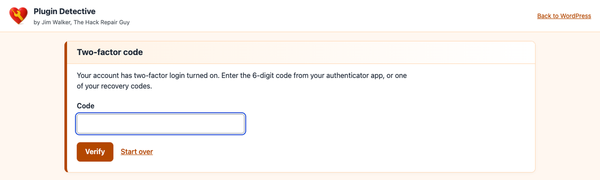
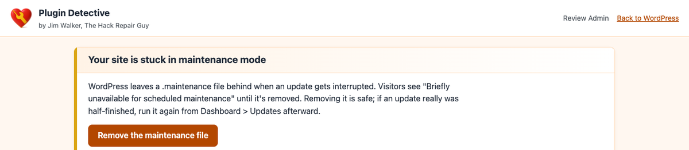
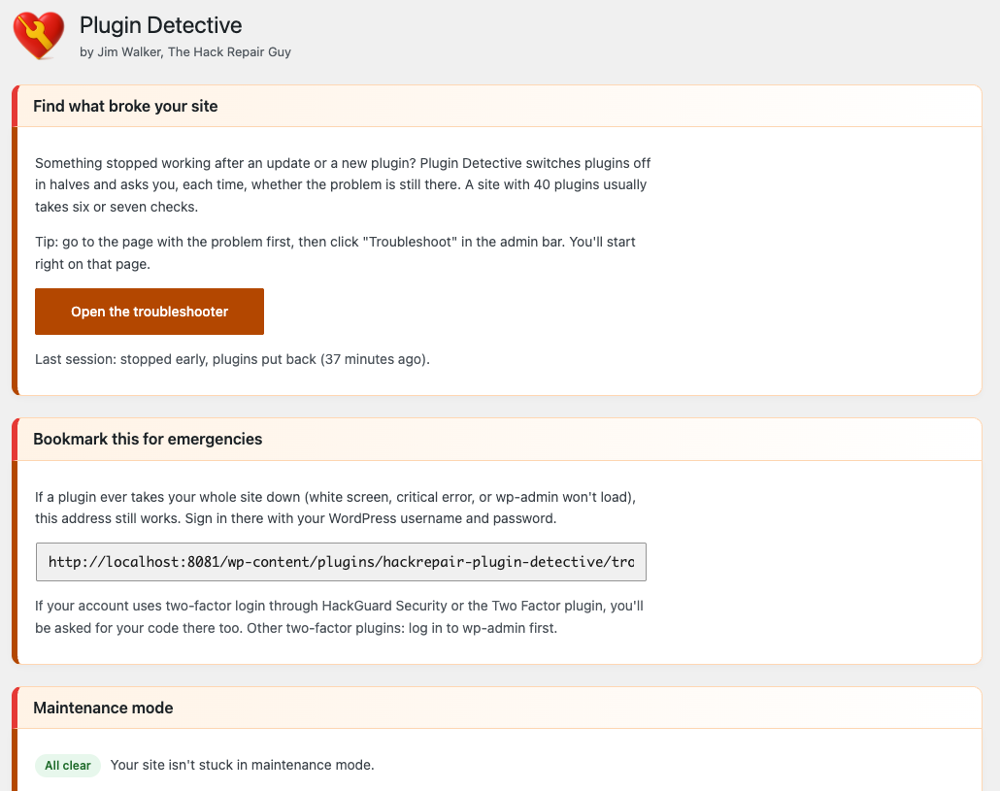
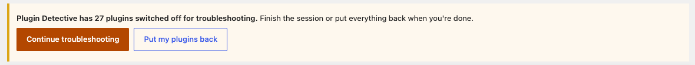
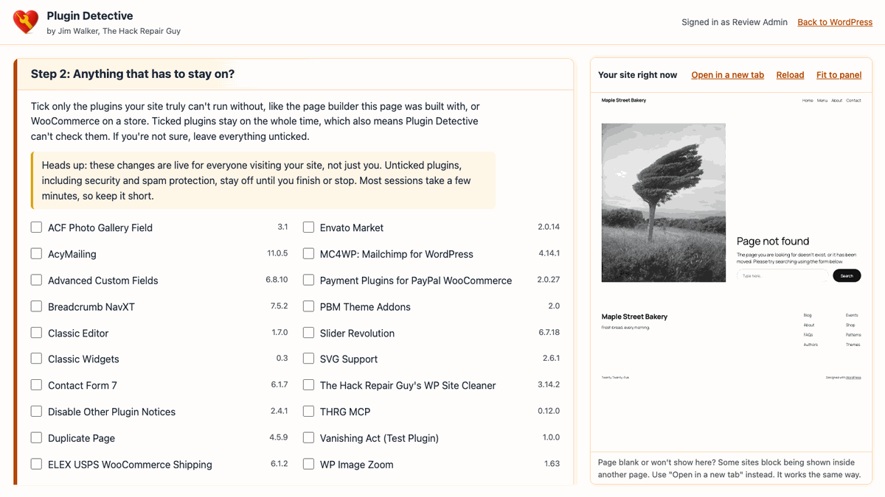
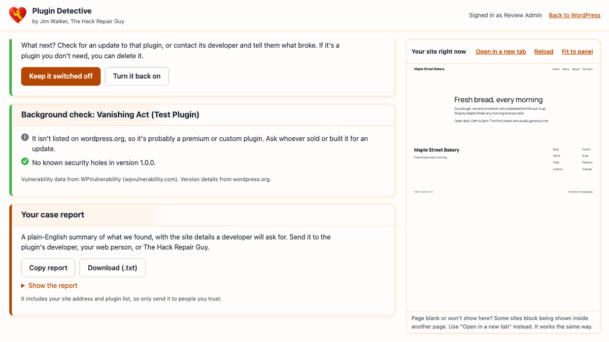

<p align="center">
  
</p>

<h1 align="center">The Hack Repair Guy's Plugin Detective</h1>

<p align="center">
  <strong>Find the plugin that broke your site in a few quick checks, even when wp-admin is down.</strong><br>
  By Jim Walker, The Hack Repair Guy
</p>

<p align="center">
  
  
  
  
  
</p>

<p align="center">
  <strong>▶ Watch it in action (1:45)</strong><br>
  <a href="https://www.youtube.com/watch?v=_KOPSGil8fs"></a>
</p>

<p align="center">
  <a href="#how-it-works">How it works</a> ·
  <a href="#features">Features</a> ·
  <a href="#screenshots">Screenshots</a> ·
  <a href="#installation">Installation</a> ·
  <a href="#security">Security</a> ·
  <a href="#faq">FAQ</a> ·
  <a href="#development">Development</a>
</p>

<p align="center">
  <a href="https://github.com/hackrepair/hackrepair-plugin-detective/releases"></a>
</p>

---

Something stopped working after an update or a new plugin. The usual advice is to switch every plugin off, then turn them back on one at a time, checking the site after each one. It works. It also takes forever.

**Plugin Detective does it in halves.** You show it where the problem is, it switches some plugins off, and you tell it whether the problem is still there. A site with 40 plugins usually takes six or seven checks. When you're done, every plugin goes back the way it was, unless you decide to keep the problem plugin switched off or delete it.

And if a plugin has taken the whole site down, white screen and all, the Fix page still opens.

<p align="center">
  
</p>

## How it works



| Active plugins | Usually | At most |
|---:|:---:|:---:|
| 10 | 4–5 checks | 6 |
| 20 | 5–6 checks | 7 |
| 40 | 6–7 checks | 8 |
| 64 | 7–8 checks | 8 |

## Features

**Fix**
- Halving search with a baseline round and a one-plugin confirmation, so the answer is predictable and fast
- "Undo my last answer" if you clicked the wrong button
- Live preview of your site in every round, plus "Open in a new tab" for logged-out or phone checks
- Mark plugins your site can't run without (a page builder, WooCommerce) so they stay on the whole time
- Plain-English results: the plugin that did it, "it's not a plugin," or "it takes more than one plugin"

**Keep it off, turn it back on, or delete it** (delete is new in 3.1.0)
- A third choice on the result screen, after "Keep it switched off" and "Turn it back on". It asks first, then removes the plugin's files and puts everything else back
- Files only: the plugin's saved settings stay in the database. It never touches this plugin or anything outside the plugins folder. If it can't delete, the plugin stays off and you're pointed to the Plugins page

**Background check on the plugin it finds** (new in 3.0.0)
- Is there a newer version? Has wordpress.org closed it? Has it gone two years without an update?
- Known security holes in the version you have, how serious they are, and whether updating fixes them, with links to the details
- Data from wordpress.org and [WPVulnerability](https://www.wpvulnerability.com/) (free, CC0, gathers CVE, Wordfence, Patchstack and WPScan). Only the plugin's folder name is sent; answers are cached for 12 hours

**Full-screen workspace** (new in 3.0.0)
- What to do next on the left two-thirds, your live site on the right third, on every screen. The left side scrolls by itself and the site stays put
- The site is drawn at desktop width and shrunk to fit; "Fit to panel" switches that off. Narrow windows stack the two

**Case report you can send** (new in 3.0.0)
- Plain-English summary: the problem page, the result, how many checks it took, what was left switched off or deleted, the background check, other active plugins, and WordPress, PHP and theme versions
- Copy or download as a `.txt`; the last report also stays on the Tools page

**Works when your site doesn't**
- Standalone Fix page that never loads plugins, must-use plugins, or the theme
- Opens during a white screen, a "critical error," or when wp-admin won't load
- Removes a stuck `.maintenance` file after an interrupted update

**Safety net**
- Your original plugin list is saved before anything changes
- wp-admin notice while plugins are switched off, with one-click **Put my plugins back**
- Deleting the plugin mid-session restores your plugins first
- Activity log of every session, plugin change, and Fix page sign-in

## Screenshots

<table>
  <tr>
    <td width="50%"><br><sub><b>Start.</b> Works whether or not wp-admin is up.</sub></td>
    <td width="50%"><br><sub><b>Found it.</b> The culprit stays off, with a background check, while you check your site.</sub></td>
  </tr>
  <tr>
    <td width="50%"><br><sub><b>Two-factor login.</b> HackGuard Security and Two Factor codes are enforced.</sub></td>
    <td width="50%"><br><sub><b>Stuck maintenance mode.</b> One button to clear it.</sub></td>
  </tr>
  <tr>
    <td width="50%"> Plugin Detective"><br><sub><b>Tools > Plugin Detective.</b> Emergency bookmark, status, and activity log.</sub></td>
    <td width="50%"><br><sub><b>Safety notice.</b> Never forget a session with plugins switched off.</sub></td>
  </tr>
  <tr>
    <td width="50%"><br><sub><b>Must stay on.</b> Tick anything your site can't run without. Your site stays in view on the right.</sub></td>
    <td width="50%"><br><sub><b>Case report.</b> Copy it or download it and send it to a developer.</sub></td>
  </tr>
</table>

## Installation

1. Download the release ZIP.
2. In WordPress, go to **Plugins > Add New > Upload Plugin**, choose the ZIP, and activate it.
3. Go to **Tools > Plugin Detective** and bookmark the emergency address.

**Site already down?** Upload the `hackrepair-plugin-detective` folder to `/wp-content/plugins/` with your host's file manager or FTP. You don't need to activate it. Open the emergency address and sign in.

### Emergency address

```
https://yoursite.com/wp-content/plugins/hackrepair-plugin-detective/fix/
```

Add `?restore=1` to go straight to the stuck-maintenance-mode fix.

## Security

Plugin Detective switches plugins on a live site, so it's built to be hard to misuse.

| Area | What it does |
|---|---|
| **Sign-in** | Recognizes an existing wp-admin login, so 2FA is already done. The Fix page's own login uses `wp_authenticate()`, gives one generic error, and locks an address out for 15 minutes after 5 failures. |
| **Two-factor** | Enforces HackGuard Security (authenticator and recovery codes) and Two Factor (authenticator codes). Accounts using WP 2FA or Wordfence Login Security are sent to wp-admin, so 2FA is never skipped. |
| **Session** | Signed, HttpOnly, SameSite=Strict cookie scoped to the Fix page folder; 2-hour life; ends when the password changes. Nothing secret appears in a URL. |
| **Requests** | POST only, same-origin check, session-bound CSRF header, and `activate_plugins` re-checked on every request. |
| **Plugin switching** | Only installed plugins can be switched on. The original list is backed up first, and every way out restores it. |
| **Deleting** | Only after a problem plugin is found and you confirm. Removes that plugin's files only, never runs its uninstall routine, refuses to touch this plugin or anything outside the plugins folder, and never follows symbolic links. If it can't delete, the plugin stays switched off. |
| **Page** | Strict Content-Security-Policy, `X-Frame-Options: DENY`, no external fonts, scripts, or tracking. |
| **Hardened hosts** | Works on sites that block PHP under `wp-content/plugins/`. A small `fix/.htaccess` re-allows only `index.php` and `api.php`; everything else stays blocked. |
| **Background check** | Runs only after a problem plugin is found, only for that plugin, and only sends its folder name. Every result is shown as text, never HTML. Turn it off with `HRPD_NO_BACKGROUND_CHECK`. |
| **Boot** | Uses WordPress's own `SHORTINIT` startup and a short list of core files. Plugin and theme code never runs in the Fix page. |

### wp-config.php settings

| Constant | Effect |
|---|---|
| `HRPD_REQUIRE_WP_LOGIN` | Turns off the Fix page's own login. Only people already logged in to wp-admin can use it. |
| `HRPD_NO_BACKGROUND_CHECK` | Turns off the background check, so the plugin never contacts wordpress.org or WPVulnerability. |
| `HRPD_EMERGENCY_PASSWORD_LOGIN` | Accepts a password without a 2FA code. Only for a real emergency when your 2FA plugin is what's broken. Remove it as soon as you're back in. |

```php
define( 'HRPD_REQUIRE_WP_LOGIN', true );
```

## Requirements

| | Minimum | Tested |
|---|---|---|
| WordPress | 6.9.4 | 7.1.3 |
| PHP | 7.4 | 7.4, 8.2, 8.3 |
| Web server | Apache, LiteSpeed, or Nginx | Apache 2.4 |
| Install type | Single site | Multisite not supported yet |

## FAQ

<details>
<summary><b>How can I try it out safely?</b></summary>

Download the free test plugin, [Vanishing Act (Test Plugin)](https://github.com/hackrepair/hackrepair-plugin-detective/raw/main/test-plugin/vanishing-act.zip), and install it from **Plugins > Add New > Upload Plugin**. Switch it on and your home page shows "Page not found." Your dashboard keeps working. Then run Plugin Detective and watch it track the culprit down. Delete Vanishing Act when you're done. It's a harmless test plugin, so don't leave it on a live site. A copy also ships inside this plugin's folder, in `test-plugin/vanishing-act.zip`.

</details>

<details>
<summary><b>How do I use it?</b></summary>

Go to the page where you see the problem and click "Fix" in the admin bar. Or go to **Tools > Plugin Detective** and click "Open Fix." Then follow the steps.
</details>

<details>
<summary><b>What does "must stay on" mean?</b></summary>

Some sites can't work at all without a certain plugin, like the page builder a page is built with, or WooCommerce on a store. Tick those, and they stay on the whole time. If you're not sure, leave everything unticked.
</details>

<details>
<summary><b>Is it safe to switch my plugins off?</b></summary>

Plugin Detective only changes which plugins are switched on. It doesn't run their deactivation routines, so their settings and data aren't touched. Every way out of a session puts your plugin list back. While you test, unticked plugins, including security plugins, are off for everyone visiting your site until you finish or stop. Keep sessions short.
</details>

<details>
<summary><b>What does "Delete this plugin" do?</b></summary>

It removes the problem plugin's files from your site, after asking you first, and turns every other plugin back on. It doesn't run the plugin's own uninstall routine, so the plugin's saved settings and data stay in your database, and a reinstall picks up where it left off. It never touches Plugin Detective itself or anything outside the plugins folder. If the files can't be removed from here, the plugin stays switched off and you can delete it from the Plugins page.
</details>

<details>
<summary><b>Where does the security information come from?</b></summary>

From [WPVulnerability](https://www.wpvulnerability.com/), a free public database that pulls together reports from CVE, Wordfence, Patchstack, WPScan and others. It lists problems by plugin and version, so Plugin Detective only shows the ones that affect the version you have. If a premium or custom plugin happens to share a folder name with a different plugin, the results may not match; the links let you check.
</details>

<details>
<summary><b>What's in the case report?</b></summary>

The problem page, the result, how many checks it took, what was left switched off or deleted, the background check, your other active plugins and their versions, and your WordPress, PHP and theme versions. It doesn't include passwords or anything from your database. It does include your site address and plugin list, so only send it to people you trust.
</details>

<details>
<summary><b>It says "It's not one of your plugins." Now what?</b></summary>

The problem was still there with the plugins off. The usual suspects are your theme, your PHP version (did your host just change it?), a plugin you marked "must stay on," must-use plugins, caching, or something on the site that shouldn't be there. If your host just changed the PHP version, an older theme or must-use plugin may not support the new one. That breaks a site just like a plugin conflict. Switch PHP back in your hosting control panel and look again. A [hacked site](https://hackrepair.com/ "Contact Jim Now?") can look a lot like a plugin conflict. If you're stuck, <a href="https://hackrepair.com/">The Hack Repair Guy can help</a>.
</details>

<details>
<summary><b>It says it takes more than one plugin.</b></summary>

No single plugin breaks it on its own, so two plugins are probably fighting each other. It can also mean the problem comes and goes, or an answer got mixed up. Clear your caches and try again.
</details>

<details>
<summary><b>The Fix page shows "403 Forbidden."</b></summary>

Your host blocks PHP inside the plugins folder. The bundled `.htaccess` handles this on Apache and LiteSpeed. On Nginx, ask your host to allow `fix/index.php` and `fix/api.php` inside the `hackrepair-plugin-detective` folder.
</details>

<details>
<summary><b>The preview is blank.</b></summary>

Some sites block being shown inside another page. Use "Open in a new tab." It works the same way.
</details>

<details>
<summary><b>Does it work on multisite?</b></summary>

Not yet. On a multisite network it stays hidden and changes nothing.
</details>

<details>
<summary><b>What happens when I delete Plugin Detective?</b></summary>

If a session is open, your plugins are put back first. Then Plugin Detective removes its own settings, activity log, and temporary data.
</details>

<details>
<summary><b>How do updates work?</b></summary>

This plugin isn't on the WordPress.org repository, so it checks its own GitHub releases. When a new version is published there, the Plugins screen shows an "update available" notice and offers a one-click update. The only outbound request this adds is the periodic check against GitHub for a newer release; nothing about your site's content, users, or configuration is sent.
</details>

## Development

### Project layout

```
hackrepair-plugin-detective/
├── hackrepair-plugin-detective.php   Plugin header and bootstrap
├── uninstall.php                     Restores plugins, removes all plugin data
├── readme.txt                        WordPress readme and changelog
├── includes/
│   ├── class-hrpd-admin.php          Tools page, admin bar link, safety notice
│   ├── class-hrpd-background.php     Background check: wordpress.org and WPVulnerability lookups
│   ├── class-hrpd-case.php           Case storage, plugin switching, restore, delete
│   ├── class-hrpd-detective.php      Search logic (no WordPress calls)
│   ├── class-hrpd-log.php            Activity log
│   ├── class-hrpd-report.php         Plain-text case report
│   └── class-hrpd-updater.php        Points WordPress at this plugin's GitHub releases, details window
├── plugin-update-checker/            Vendored third-party library (see Standards below)
├── fix/
│   ├── index.php                     Standalone Fix page
│   ├── api.php                       Standalone JSON API
│   ├── .htaccess                     Allows only the two entry points on hardened hosts
│   ├── assets/                       app.js and app.css (no build step)
│   └── includes/
│       ├── bootstrap.php             SHORTINIT boot and core file list
│       ├── class-hrpd-app.php        API router and page data
│       ├── class-hrpd-login.php      Password login, lockout, 2FA challenge
│       ├── class-hrpd-session.php    wp-admin cookie and Fix page session
│       ├── class-hrpd-strings.php    Every word the Fix page shows
│       └── class-hrpd-totp.php       Two-factor detection and code checks
├── test-plugin/                      Vanishing Act, a harmless plugin that 404s the home page, for trying the detective
└── assets/                           Admin CSS and JS, mascot images, details-window screenshots and banners
```

### Standards

- WordPress Coding Standards and PHPCompatibilityWP (`testVersion 7.4-`): `phpcs` (config in `phpcs.xml.dist`). Last run clean on 2.1.0; run it again before each release
- PHP 7.4 floor, PHP 8.3 style where 7.4 allows it
- No build step, no external assets or tracking in the Fix page UI
- All user-facing copy lives in `fix/includes/class-hrpd-strings.php` and `includes/class-hrpd-admin.php`, translatable under `hackrepair-plugin-detective`
- Updates are checked against this plugin's own GitHub releases (`hackrepair/hackrepair-plugin-detective`), the same way WordPress checks wordpress.org for everything else, using the vendored [Plugin Update Checker](https://github.com/YahnisElsts/plugin-update-checker) library (MIT licensed, by Janis Elsts). The only other outside calls are the background check on a found plugin (wordpress.org and WPVulnerability, plugin folder name only). No telemetry

### Verified in 3.2.1

| Check | Result |
|---|---|
| Browser click-through of the delete button (three buttons show, asks first, "No" backs out, "Yes" deletes the files, done screen, report and Tools page all say deleted) | 12 / 12 |
| Delete the problem plugin (refuses itself and path tricks, ignores unsolved cases, removes nested files, leaves symlink targets alone, single-file plugins, plugin list and report updated) | 15 / 15 |
| Update URI "false" wording, and other hosts still named | 3 / 3 |
| "View details" window (sections, screenshots, banners, icons, version) | 18 / 18 |
| Vanishing Act test plugin: installs and activates cleanly, home page 404, login still 200, back to 200 when off | Pass |

### Verified in 3.0.0

| Check | Result |
|---|---|
| Background check and case report logic (version ranges, live lookups, closed and missing plugins, report text) | 33 / 33 |
| Background check from the lightweight Fix page boot (HTTP loaded on demand) | Pass |
| Browser click-through: find a plugin with known holes, background card, report copy/download, keep off, Tools page report | 16 / 16 |
| Browser layout check (2/3 and 1/3 split, fits the window, left side scrolls alone, desktop scaling, narrow-window stacking) | 18 / 19 (the one miss was a test threshold, not the page) |
| API end-to-end (unchanged suite) | 52 / 52 |

### Verified in 2.1.1

| Check | Result |
|---|---|
| API end-to-end (login, 2FA, lockout, search, undo, restore, maintenance, cancel at Step 2) | 52 / 52 |
| Browser walkthrough (desktop and phone) | 22 / 22, no JavaScript errors |
| White-screen recovery (crashing plugin, site and wp-admin returning 500) | Found in 7 checks, site back to 200 |
| `php -l` on PHP 8.3 | Clean |

PHP 7.4 lint and PHPCS (WordPress + PHPCompatibilityWP) were clean on 2.1.0. PHPCS has not been re-run since 3.0.0.

## Credit

The idea for The Hack Repair Guy's Plugin Detective came from [Plugin Detective – Troubleshooting Conflicts](https://wordpress.org/plugins/plugin-detective/) by NSquared. Thank you to Natalie MacLees and team for showing how handy a guided, halving search can be.

This is an independent rebuild with new code, design, and copy, and it isn't affiliated with or endorsed by NSquared. What it adds:

- Two-factor enforcement on the Fix page's own login, plus rate limiting and an activity log
- A wp-admin safety notice with a one-click "Put my plugins back"
- A plain warning that plugins switched off during a session are off for everyone visiting your site
- Works on hardened hosts that block PHP inside the plugins folder
- The problem plugin stays off and everything else comes back on, so you can check your site before deciding
- A background check on the plugin it finds, including known security holes, and a case report you can send
- No outside fonts, scripts, or tracking; updates come from this plugin's own GitHub releases

## Changelog

See the **Changelog** section of [`readme.txt`](readme.txt).

## Support

Found a problem plugin and need a hand with the next step? Or the Fix page says it isn't a plugin at all? **[The Hack Repair Guy can help.](https://hackrepair.com/)**

## License

GPLv2 or later. See [`LICENSE`](LICENSE).

<p align="center">
  <sub>Made by <a href="https://hackrepair.com/">Jim Walker, The Hack Repair Guy</a></sub>
</p>
